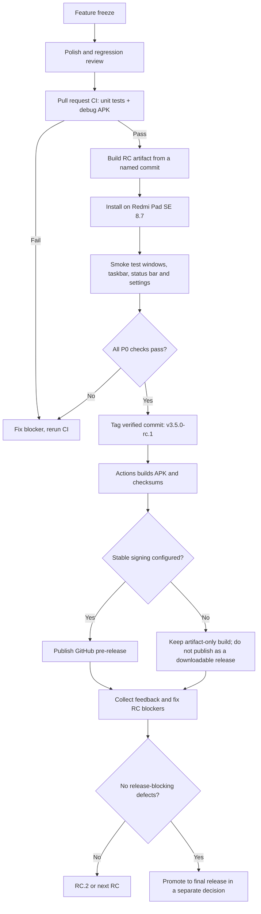

# DevDex Release Candidate flow

**Purpose:** produce a traceable, installable Release Candidate without adding new features or calling the build stable before device validation.

## Release path

## Build outputs

The **Build APK** workflow supports three paths:

- **Pull request / main branch:** run `testDebugUnitTest` and build a debug APK for CI validation.
- **Run workflow manually:** choose an explicit version such as `3.5.0-rc.1`; download the generated artifact from the run.
- **Push a branch named `release/<version>`:** for example, `release/3.5.0-rc.1` automatically builds a version-labelled candidate artifact for physical-device testing without publishing a release.
- **Push a tag matching `v*-rc.*`:** use the tag as the version, build the candidate and publish a GitHub pre-release only when the stable signing key is configured.

Every build should include the APK, SHA-256 checksums and build metadata (version, commit SHA and Actions run). The package ID remains `com.youki.dex` for compatibility with existing installations.

## Stable signing requirement

Configure these GitHub Actions secrets together before publishing a downloadable pre-release:

- `DEVDEX_KEYSTORE_BASE64`
- `DEVDEX_KEYSTORE_PASSWORD`
- `DEVDEX_KEY_ALIAS`
- `DEVDEX_KEY_PASSWORD`

All four must refer to the same long-lived signing identity used for prior DevDex builds. Never rotate the key for an in-place upgrade and never commit a keystore to this repository. If the secrets are missing, CI may still provide a debug APK for testing, but the workflow must not publish it as the official RC release.

## RC go/no-go checklist

### Automated gate

- [ ] Pull request CI passes: `testDebugUnitTest` and `assembleDebug`.
- [ ] Manual/tagged candidate build completes.
- [ ] APK and SHA-256 checksum are present.
- [ ] Record the exact commit SHA and `versionCode` / `versionName`.
- [ ] If publishing a release APK, confirm stable signing was configured and the APK is signed.

### Physical-device smoke test

Use the Redmi Pad SE 8.7 running the exact HyperOS/Android build shown under **Settings → About tablet**. Record the firmware build in the test notes.

- [ ] Fresh install and onboarding complete; English and Vietnamese selection work.
- [ ] Upgrade install over the previous DevDex APK succeeds without uninstalling and preserves settings.
- [ ] Open two unrelated apps and verify both remain independently visible and usable at once; test focus changes and taskbar switching.
- [ ] Resize/restore and close controls work; fullscreen activities do not receive DevDex window-control overlays.
- [ ] Controls remain visible during focus changes, dock show/hide, rotation and brief Shizuku disconnects. Failed system operations show a meaningful failure rather than a false success.
- [ ] Status bar is visible by default; its setting changes the behavior predictably.
- [ ] Opacity control is separate from resize; changing one does not trigger the other.
- [ ] A floating-window app remains visible when switching between DevDex and other apps, where Android permits it.
- [ ] Media controls appear only when media is playing and do not leave stale taskbar UI after playback ends.
- [ ] Settings backup/export and restore/import succeed, including legacy `.sdp` compatibility.
- [ ] Test app launch, dock interaction, Settings, file manager, browser, video playback, keyboard/mouse if available, and window bounds near screen edges.
- [ ] Reboot and repeat core launch/window checks once.
- [ ] Keep a regular launcher available and confirm sensitive apps are not blocked by overlays.

### Release decision

**Do not call the RC passed based on CI alone.** CI verifies that the code builds and unit tests run; it cannot prove freeform window behavior, Shizuku recovery, stable-signature continuity or HyperOS-specific behavior on the physical tablet.

A blocker affecting install/update, launch, window close/resize, multi-app usability, permissions, data/settings preservation or device recovery means the candidate stays in RC and is not promoted to stable.
